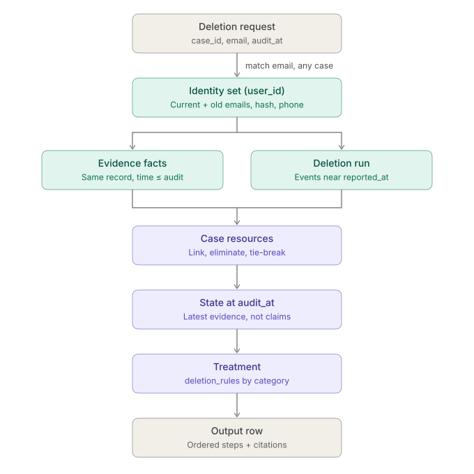
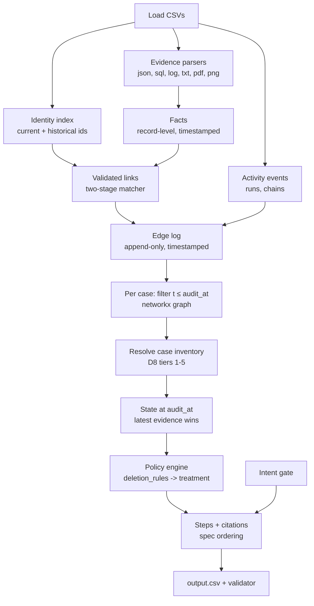
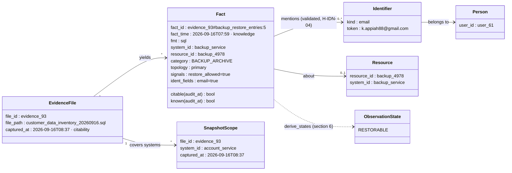
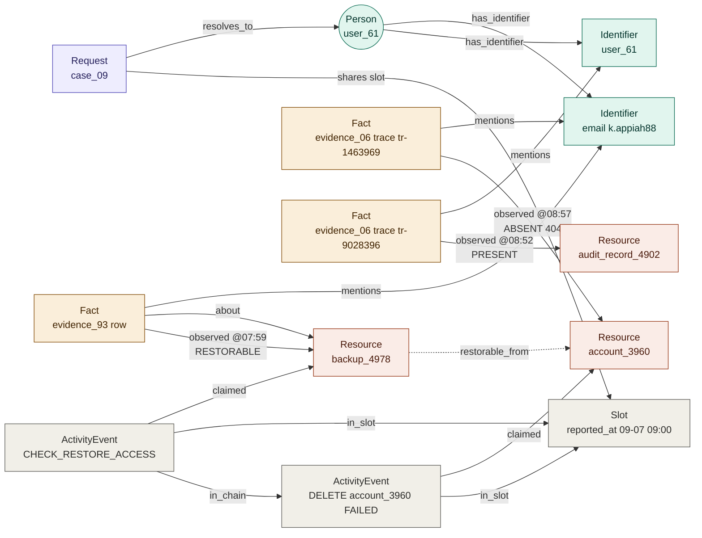
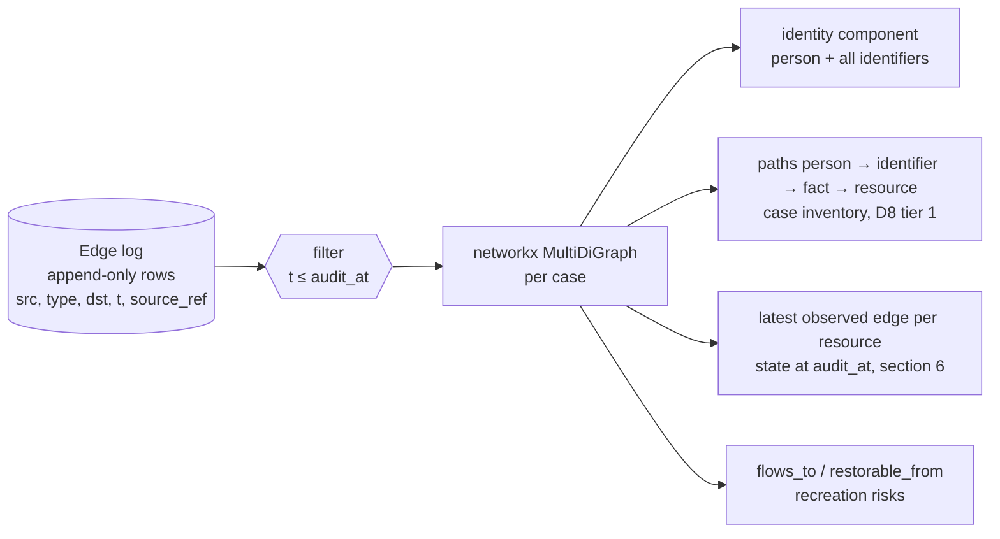

# Design — Ghost Data Still Exists (deletion-audit agent)

Version 1.0 · 2026-10-25 01:10 IST · Status: **approved for build**. Planning document; the deliverables live in `code/`, `output.csv`, `log.txt`.

Authoritative inputs this design builds on (read them before coding):

| Doc                                                                 | What it holds                                                                                     |
|---------------------------------------------------------------------|---------------------------------------------------------------------------------------------------|
| `problem_statement.md` (Required Output, Allowed Operations, Rules) | **The contract** (D2)                                                                             |
| `docs/DECISIONS.md`                                                 | D1–D9: frozen decisions (D8 adopted, open to revision)                                            |
| `docs/RULES.md`                                                     | Rule register: SPEC / HARD / GOOD / WEAK / GAP, with stable IDs. Code cites rule IDs in comments. |
| `docs/SAMPLE_DEEP_DIVE.md`                                          | Per-sample evidence analysis, worked examples (§5.1–5.5, §6.1)                                    |
| `docs/SCREENSHOTS.md`                                               | Screenshot pipeline (§5–7)                                                                        |
| `docs/EDA_ghost_data.ipynb`, `docs/probes/P*.py`                    | Evidence for every rule. **The probes are reference implementations: port them, don't reinvent.** |
| `docs/deletion_case_linkage_chain.svg`                              | The linkage chain diagram                                                                         |



---

## 1. Principles (non-negotiable)
1. **Deterministic core, narrow LLM.** Rules decide; LLMs only *read* (intent text, screenshot meaning, D8 tier-4 residuals) and are cached.
2. **Evidence over claims.** `reported_status` / `reported_result` never decide state (S-EVD-01, H-STA-02).
3. **Time travel per case.** Knowledge = record-level timestamp ≤ `audit_at` (inclusive); citations = files with `captured_at` ≤ `audit_at` (D3, H-TIM-02/03).
4. **Exact identity.** Loose retrieval, exact validation against the full identity set; names never link (H-IDN-04).
5. **Contract first.** Output format, operation vocabulary and ordering exactly per `problem_statement.md` (D2); row order = numeric case order (D1).
6. **Traceable.** Every emitted step carries (internally) the rule IDs and evidence path that produced it; an explain/debug dump exists per case.
7. **Robust to unseen data.** No absolute pixel coordinates, no hard-coded file names / case IDs / resource IDs, generic parsers, graceful fallbacks.

## 2. Architecture

Batch, single process: `python3 code/main.py` → reads `dataset/`, writes `output.csv` at repo root.

## 3. Repository layout
```
code/
  main.py                      # CLI entry: run full pipeline, write ./output.csv
  requirements.txt             # pinned deps
  ghost/
    config.py                  # paths, model names, feature flags (D8 tiers on/off), env-var keys
    loaders.py                 # CSV loading, typed records, time parsing (UTC)
    identity.py                # identity sets, two-stage matcher, decoy log
    evidence/
      __init__.py              # dispatch by extension + content sniffing
      json_parser.py           # generic record walker (dict with resource_id = record)
      sql_parser.py            # sqlite3 in-memory executescript → rows (+ JSON payload columns)
      log_parser.py            # format-agnostic: timestamp + trace id + key=value/JSON extraction
      txt_parser.py            # line records (pipe tables, key: value)
      pdf_parser.py            # pdftotext → text, pypdf fallback
      image_parser.py          # D5 pipeline (geometry + OCR) + vision-LLM semantic pass
      normalize.py             # → Fact objects: system_id, resource_id, identifiers, signals, fact_time
    facts.py                   # Fact / Observation dataclasses, state derivation from signals
    catalog.py                 # resource prefix → system_id, data_category; vocabulary (X-SYS-01)
    edgelog.py                 # append-only edge log + per-case networkx graph (D7)
    runs.py                    # deletion runs: slots, windows (G-LNK-01), phase chains (W-LNK-05)
    resolve.py                 # D8 tiers: hard → park → eliminate → chains → LLM → tie-break
    state.py                   # state at audit_at per resource
    policy.py                  # deletion_rules.csv → treatment; finding/remediation/verify (H-STP-01/07)
    citations.py               # evidence selection (G-CIT-01/02, G-EVD-01/06, X-CIT-01)
    steps.py                   # step objects, ordering (S-ORD-02), numbering, JSON serialisation
    intent.py                  # request intent: rules + LLM, multilingual
    llm.py                     # provider abstraction (Anthropic, Ollama), cache, usage ledger
    llm_profiles.py            # D11: `local` (Ollama) and `final` (Anthropic) role → model maps
    validate.py                # output contract validator
    explain.py                 # per-case debug dump (paths, rule IDs, decisions)
  cache/                       # LLM + image extraction cache (JSON, keyed by content hash)
  evaluation/
    main.py                    # harness: metrics vs sample_output, ablations, custom cases
    custom_cases/              # our additional evaluation cases (inputs + expected)
    evaluation_report.md       # generated + curated
    usage_report.md            # generated from the usage ledger of the final full run
  tests/                       # pytest unit tests per module (inside code/ so they ship in code.zip)
```
Root `README.md` gets a "Solution" section (setup, run, architecture summary). `code.zip` = `README.md` + `code/` (per README packaging command).

## 4. Data model
### 4.1 Fact (one evidence record, after normalisation)
| Field                         | Meaning                                                                                                                                                                                                                                                     |
|-------------------------------|-------------------------------------------------------------------------------------------------------------------------------------------------------------------------------------------------------------------------------------------------------------|
| `fact_id`                     | stable id `file_id#locator` (row / trace / object path / line / region)                                                                                                                                                                                     |
| `file_id`, `file_captured_at` | from `evidence_files.csv`; decides **citability** (≤ audit_at)                                                                                                                                                                                              |
| `fact_time`                   | record-level time (inner `captured_at`, `observed_at`, `updated_at`, log line time, snapshot_scope); decides **knowledge** (≤ audit_at). Fallback: `file_captured_at`                                                                                       |
| `system_id`                   | normalised via `catalog.py` (replica copies → base system, G-SYS-01)                                                                                                                                                                                        |
| `resource_id`                 | e.g. `account_3960`; may be absent (→ G-POL-02: no step)                                                                                                                                                                                                    |
| `identifiers`                 | validated identifiers found in the record (emails, hashes, phones, `user_NN`)                                                                                                                                                                               |
| `signals`                     | raw state signals: `http_status`, `rows`, `enabled`, `restore_allowed`, `eligible`, `deletion_block`, `marker_found`, `retention_until`, handover `result/state`, identifier-field null/non-null map, `record_type`/category labels, `connector_name`, etc. |
| `scope`                       | for snapshots: which systems the capture covers (used for proof of absence, G-EVD-01)                                                                                                                                                                       |


**Diagram 4.1: a Fact and what it connects to** (Mermaid class diagram; example values from case_09)

Two clocks per Fact: `fact_time` decides what is **known** at `audit_at` (D3), and the file's `captured_at` decides what is **citable** (S-TIM-01). A `SnapshotScope` proves absence for every resource of its system that is missing from it (G-EVD-01).

### 4.2 Edge log (D7)
Append-only rows `(src, edge_type, dst, t, source_ref, attrs)`:

| edge_type                      | src → dst                               | from                                                      |
|--------------------------------|-----------------------------------------|-----------------------------------------------------------|
| `has_identifier`               | Person → Identifier                     | identities + audit log (t = change time; historical kept) |
| `mentions`                     | Fact → Identifier                       | validated matches                                         |
| `about`                        | Fact → Resource                         | fact resource_id                                          |
| `observed`                     | Fact → Resource, attrs.state            | state derivation (§6)                                     |
| `claimed`                      | ActivityEvent → Resource, attrs.result  | system_activity (claims only)                             |
| `in_slot` / `in_chain`         | ActivityEvent → Slot / Anchor           | runs.py                                                   |
| `flows_to` / `restorable_from` | Resource → Resource / Backup → Resource | connectors, restore events, LINK events                   |
| `linked_by_catalog`            | Resource → Person                       | `LINK_RESOURCE_IDENTITY` activity                         |
Per case: `graph = build(edges where t ≤ audit_at)`; `networkx.MultiDiGraph`. Export GraphML in debug mode.


**Diagram 4.2: the edge-log graph for one case** (node and edge types; example: case_09 at audit_at 2026-09-16 09:00)

How to read it: **evidence edges** (`mentions`, `about`, `observed`) decide ownership and state. **Activity edges** (`claimed`) are kept but never set state (H-STA-02). **Run edges** (`in_slot`, `in_chain`) are used only to resolve ownership (D8). Every edge carries a time `t`, and the per-case graph keeps only edges with `t ≤ audit_at` (D3, inclusive per H-TIM-03). The dashed `restorable_from` edge is what makes a backup a recreation path (REPORT_RESTORE_RISK).

**Diagram 4.2b: from the edge log to a per-case graph**


### 4.3 Case result (internal)
`CaseResult{case_id, status, resources:[ResourceDecision], steps:[Step], tier_trace, confidence, notes}` where `ResourceDecision{resource_id, system_id, category, state_at_audit, treatment, finding?, remediation?, verification, evidence_id, rule_ids, link_tier}`.

## 5. Evidence parsing (all formats → Facts)
General rules: files on the Windows build machine have **CRLF line endings** (git autocrlf); open text with universal newlines, and never assume `\n`. Parse **every** file in `evidence_files.csv` (never skip by name); dispatch by extension, then sniff content; never hard-code file names. Each parser yields raw records `{locator, fact_time, fields, text}`; `normalize.py` turns them into Facts (catalog lookup, identifier extraction + validation, signal extraction).

| Format   | Seen shapes                                                                                                                                                                                                                                                                                | Parsing approach                                                                                                                                                                                                                                                                                                                                                                                                                                                                                                                                                                                                                                                                             |
|----------|--------------------------------------------------------------------------------------------------------------------------------------------------------------------------------------------------------------------------------------------------------------------------------------------|----------------------------------------------------------------------------------------------------------------------------------------------------------------------------------------------------------------------------------------------------------------------------------------------------------------------------------------------------------------------------------------------------------------------------------------------------------------------------------------------------------------------------------------------------------------------------------------------------------------------------------------------------------------------------------------------|
| **JSON** | `service_exports.{system}.{list}[]` (service_resource_export), `snapshots[]{captured_at,data_store,collection,records[]}` (bundles), `records[]` with `captured_at`/`exported_at` (analytics report, export jobs/manifest, connectors, security ledger)                                    | Generic walker: any dict with `resource_id` is a record. Inherit nearest `captured_at` / `observed_at` / `updated_at` / `exported_at` (innermost wins) as `fact_time`. Inherit `system_id` from parent key (`service_exports.<system>`) or `data_store`, else from the resource prefix.                                                                                                                                                                                                                                                                                                                                                                                                      |
| **SQL**  | inventory snapshots (`snapshot_scope` + typed tables), replica captures (`customer_data_primary` / `_read_replica` / `_replica_<region>` / `_reporting_replica` / `_failover_replica` with JSON payload column), `customer_profiles_primary/_failover_replica`, `search_documents_primary` | `sqlite3` in-memory `executescript`, then iterate all tables. Parse JSON text columns. Table name → topology (`primary`, `replica:<kind>`); `snapshot_scope` → per-system capture time + **scope** (which systems the snapshot covers, needed for absence proofs). Row `updated_at` → fact_time when present. Replica rows map to the base system (G-SYS-01).                                                                                                                                                                                                                                                                                                                                |
| **Logs** | `key=value`, `[LEVEL] [service] [trace] event: k="v"`, JSON after timestamp, pipe-separated, syslog RFC5424, cloud runtime with nested escaped `message="k=\"v\""`                                                                                                                         | **Format-agnostic**: leading ISO timestamp = line time; trace id by regex (`trace_id`, `requestId`, bracketed or bare `tr-…`/`rb-…`); key/values from JSON or from a `(\w+)=("(?:[^"\\]                                                                                                                                                                       \|\\.)*"\|\S+)` scanner (unescape nested). **Group lines by trace id** → one record per trace (H-LNK-03): identifiers from `lookup_key/subject_key/subject_ref/match_key/correlation_key/...`, resource + signals from completed/evaluated lines; fact_time = latest line time in the trace. Lines without trace = own record. |
| **TXT**  | handover `- time \| system \| resource \| CATEGORY \| STATE \| identifier`                                                                                                                                                                                                                 | Line records; pipe-split when ≥4 pipes; otherwise `key: value`. Explicit category/state labels are trusted signals.                                                                                                                                                                                                                                                                                                                                                                                                                                                                                                                                                                          |
| **PDF**  | text PDFs (`Record`/`Detail` key–value layout)                                                                                                                                                                                                                                             | **`pypdf` (pure Python, primary)**; it extracts identical identifiers to `pdftotext` on all 4 PDFs (checked 2026-10-25), so **poppler is not required**; `pdftotext -layout` optional if present. One record per document (plus resource-id-anchored sub-records). fact_time = dates in text if parseable, else file captured_at.                                                                                                                                                                                                                                                                                                                                                            |
| **PNG**  | dashboard screenshots (D5)                                                                                                                                                                                                                                                                 | §5.1                                                                                                                                                                                                                                                                                                                                                                                                                                                                                                                                                                                                                                                                                         |

### 5.1 Screenshot pipeline (D5, see SCREENSHOTS.md §5–7; port `P09_region_labelling.py` v3)
1. Geometry image: grayscale → invert if median < 128 → contrast stretch → black-hat 7×7 > 3 → long-line opening (w/20, h/25) → rectangles → labels: green = largest; red = ≥3 wide cards above green; right column top-down: blue (merge thin title bar) and yellow; black = band above red.
2. Text image: grayscale → invert if dark → contrast curve → upscale (text height ≈ 30 px) → tesseract per region; green split into row strips at detected row lines (`--psm 7`).
3. Semantic pass (**conditional, D5a**): vision LLM on the whole image only when a quality gate fails (fewer regions than expected; no validated identifier/resource id in title bar + detail panel; an OCR candidate failing exact validation; tesseract missing). Strict JSON schema `{entity_header{title,ids[],emails[],phones[]}, kpis[{label,value}], table{columns[],rows[[]]}, detail{record_id, fields[{label,value}]}, timeline[{time,event}], all_identifiers[]}`.
4. Validation: OCR-extracted identifiers and resource ids go through the two-stage matcher (H-IDN-04; resource ids validated against ids known from activity and text evidence, e.g. clipped `jport_1034` → candidate `support_1034` → exact check). When L2 ran, an identifier is accepted iff LLM ∧ (OCR text ∨ known identity/resource); else flagged low-confidence (never the sole basis of a finding).
5. Output → records: the **detail panel (+ title bar) = subject record** (W-EVD-04, to verify); table rows = separate records (decoys get filtered by identity validation naturally).
6. Fallback: if < 3 regions found or tesseract missing → vision-LLM only; if no LLM → OCR-only with all-identifier harvesting.
7. Cache keyed by image sha256. Committed cache allows offline reproduction.

## 6. State derivation (signals → observation state)
| Observation state                | Signals (any)                                                                                                                                                                                                                    |
|----------------------------------|----------------------------------------------------------------------------------------------------------------------------------------------------------------------------------------------------------------------------------|
| `ABSENT`                         | `http_status=404`, `rows=0`, `result/state=NOT_FOUND`, `status=404`+`profile=null`, deleted marker; **or** resource missing from a snapshot whose scope covers its system and whose time ≥ the case's run anchor (absence proof) |
| `PRESENT`                        | row exists, `rows≥1`, `http_status=200`, `FOUND`, `result=hit`, `account_status ∈ {ACTIVE, DELETION_PENDING}`                                                                                                                    |
| `IDENTIFIABLE` (exposed)         | any **prohibited** identifier field non-null for the category (§7.2)                                                                                                                                                             |
| `ANONYMIZED` / `REDACTED`        | all prohibited fields null (`ANONYMIZED` label, `no direct identifier`, `REDACTED` label)                                                                                                                                        |
| `FLOW_ACTIVE` / `FLOW_DISABLED`  | `enabled=true/1`, `scheduler_registered=true`, heartbeat, `ACTIVE` / `enabled=false/0`, `stopped`, `DISABLED`                                                                                                                    |
| `RESTORABLE` / `RESTORE_BLOCKED` | `restore_allowed=1/true`, `eligible=true ∧ deletion_block=false`, `ACTIVE` / `restore_allowed=0/false`, `deletion_block=true`, `BLOCKED`                                                                                         |
| `RETAINED`                       | security audit/legal hold present with `retention_until`/hold active ≥ audit_at                                                                                                                                                  |
Rules: **state at audit = latest observation with fact_time ≤ audit_at and ≥ the run anchor time** (pre-deletion snapshots are history, used only for linking). Activity `reported_result` never sets state (H-STA-02). No observation at all → `UNKNOWN` → no finding (cannot be cited), verification still emitted (H-STP-04), confidence flagged.

## 7. Catalog and policy
### 7.1 Resource catalog (`catalog.py`) — vocabulary is closed (X-SYS-01)
| Prefix            | system_id                                                      | data_category (default) | Refinements                                                                                                                              |
|-------------------|----------------------------------------------------------------|-------------------------|------------------------------------------------------------------------------------------------------------------------------------------|
| `account_`        | account_service                                                | USER_PROFILE            | replica / failover copies → same system + id (G-SYS-01)                                                                                  |
| `search_`         | search_service                                                 | SEARCH_INDEX_ENTRY      |                                                                                                                                          |
| `analytics_`      | analytics_platform                                             | ANALYTICS_PROFILE       | contact-lookup with `email_opt_in` → treated as DELETE (W-POL-01, flag `analytics_contact_delete=True`)                                  |
| `support_`        | support_platform                                               | SUPPORT_MESSAGE         | → SUPPORT_ATTACHMENT if label says attachment / document / file object; legacy `support_replica` copy with `marker_found=false` → DELETE |
| `export_`         | export_service                                                 | USER_EXPORT             |                                                                                                                                          |
| `data_flow_`      | integration_service                                            | (data flow)             | flows are processes, not data records                                                                                                    |
| `backup_`         | backup_service                                                 | BACKUP_ARCHIVE          |                                                                                                                                          |
| `audit_record_`   | security_service                                               | SECURITY_AUDIT_LOG      |                                                                                                                                          |
| `tombstone_`      | identity_service                                               | ACCOUNT_TOMBSTONE       |                                                                                                                                          |
| `cache_`          | cache_service                                                  | CACHE_ENTRY             | gap X-POL-01: rule default                                                                                                               |
| `email_delivery_` | email_delivery_service                                         | EMAIL_DELIVERY_LOG      | gap: rule default                                                                                                                        |
| `marketing_`      | marketing_platform                                             | MARKETING_PROFILE       | gap: rule default                                                                                                                        |
| `legal_hold_`     | legal_service                                                  | LEGAL_HOLD_RECORD       | gap: rule default                                                                                                                        |
| `object_`         | **open question OQ-1**                                         | SUPPORT_ATTACHMENT?     | sample attachment was reported as `support_platform/support_001`                                                                         |
| other / unknown   | from parent key, else `unknown:<prefix>` → **no step**, logged |                         |                                                                                                                                          |

### 7.2 Policy (`policy.py`, driven by `deletion_rules.csv`, never hard-coded beyond condition evaluators)
| Category                                                                                                                | Required action             | Prohibited fields (exposure test)                           | Compliant state → verify                                           | Violating state → finding / remediation                   |
|-------------------------------------------------------------------------------------------------------------------------|-----------------------------|-------------------------------------------------------------|--------------------------------------------------------------------|-----------------------------------------------------------|
| USER_PROFILE, SEARCH_INDEX_ENTRY, CACHE_ENTRY, USER_EXPORT, MARKETING_PROFILE, SECONDARY_IDENTIFIER, SUPPORT_ATTACHMENT | DELETE                      | —                                                           | ABSENT → VERIFY_RECORD_ABSENT                                      | PRESENT → REPORT_REMAINING_RECORD / DELETE_RECORD         |
| ANALYTICS_PROFILE, PRODUCT_TELEMETRY                                                                                    | ANONYMIZE                   | email, phone, name, email_hash, user_id, customer_reference | ANONYMIZED → VERIFY_RECORD_ANONYMIZED                              | IDENTIFIABLE → REPORT_EXPOSED_PII / ANONYMIZE_RECORD      |
| SUPPORT_MESSAGE, EMAIL_DELIVERY_LOG, ACCOUNT_TOMBSTONE                                                                  | REDACT                      | name, email, phone, email_hash (**stable ref allowed**)     | REDACTED → VERIFY_RECORD_REDACTED                                  | IDENTIFIABLE → REPORT_EXPOSED_PII / REDACT_RECORD         |
| SECURITY_AUDIT_LOG, LEGAL_HOLD_RECORD                                                                                   | RETAIN (if condition holds) | —                                                           | PRESENT/RETAINED → VERIFY_RECORD_PRESENT (no finding, H-STP-06)    | ABSENT while required → *open question OQ-3*              |
| BACKUP_ARCHIVE                                                                                                          | RETAIN + restore blocked    | —                                                           | RESTORE_BLOCKED → VERIFY_RESTORE_BLOCKED (never PRESENT, H-STP-07) | RESTORABLE → REPORT_RESTORE_RISK / BLOCK_RESTORE          |
| data flow                                                                                                               | (process)                   | —                                                           | FLOW_DISABLED → VERIFY_DATA_FLOW_DISABLED                          | FLOW_ACTIVE → REPORT_ACTIVE_DATA_FLOW / DISABLE_DATA_FLOW |
Every remediated or compliant resource gets exactly one verification (H-STP-04); at most one finding per resource (H-STP-04; X-STP-01 open). Status: **NOT_APPLICABLE** if intent says no deletion; else **INCOMPLETE** if ≥1 finding; else **COMPLETE**.

Gap defaults (flag-controlled, reported in evaluation): expired retention / hold (X-POL-03) → treat as not retained → DELETE semantics (**OQ-2**); retained record with prohibited identifiers (X-POL-04) → no finding (retain as-is) (**OQ-3**); unblockable restore (X-POL-05) → finding RESTORE_RISK anyway; unresolvable email (X-IDN-02) → `COMPLETE` with `[]`? → **OQ-4** (current default: INCOMPLETE is impossible without findings, so COMPLETE + `[]`, logged).

## 8. Identity, linking and case inventory
### 8.1 Identity (`identity.py`, H-IDN-02/03/04)
- Identity set per user: current + all historical emails (lowercased), email hashes (current, historical, and sha256 of every email), phones (digits-normalised, current + historical), `user_id`.
- Request → user: exact lowercased/trimmed email lookup over current ∪ historical (all 550 resolve).
- **Two-stage matcher**: stage 1 recall (substring / regex over raw text); stage 2 exact token validation against the identity set. Outcomes `EXACT | SAME_USER_OTHER_ID | OTHER_USER | UNKNOWN_DECOY`; only the first two create `mentions` edges; decoys go to a decoy log (useful for the evaluation report). Names never link.

### 8.2 Runs (`runs.py`, G-LNK-01, P10)
- Slot = `reported_at` value; cases sharing it share the slot (sample + eval together, they share one activity stream).
- Windows relative to `reported_at`: anchor ("submitted primary profile") −80…−40 min; policy action ("Policy action completed") −35…0; final result / checks +30…+125; scenario style (other deletion_worker messages) −10…+15.
- Chains (W-LNK-05, tier 3b): follow-up joins anchor if `(t_e − t_a) mod 30 s` ∈ 9–11 (policy) / 20–22 (final, check); single match → chain member, multi → parked.

### 8.3 Resolution tiers (`resolve.py`, D8; each tier switchable via config, contribution reported)
1. **Hard**: slot event (or evidence-only resource) whose resource has a validated `mentions` path to exactly one slot case at fact_time ≤ that case's audit_at. Evidence-only resources (audit records, replica copies, attachments, legacy copies) are added to the case if linked (inventory = run ∪ evidence-only, G-LNK-01).
2. **Park**: ambiguity table `resource → candidate cases, candidate rules`.
3. **Eliminate** to fixpoint: exactly one account per case (H-STP-02), at most one resource per type (H-STP-05), every slot event belongs to exactly one slot case.
4. **Chains (3b)**: a chain linked through any member carries all members; re-run 3.
5. **LLM** only if the residual hinges on unstructured content (e.g. screenshot / free text); prompt contains the parked candidates, the evidence snippets and the candidate rules; answer must be one of the candidates + cited reason; validated; cached.
6. **Tie-break** (deterministic): no ordering signal exists between cases and anchors (P04), so an unresolved symmetric account pair is assigned by a fixed documented rule: remaining anchors sorted by `event_time` are paired with remaining cases sorted numerically by `case_id`. Mark `confidence=low`. Optional types left unresolved are **not** emitted (no step for a record we cannot attribute), except accounts, which are always emitted (H-STP-02).

## 9. Citations (`citations.py`)
- Only file ids (G-CIT-01) with `captured_at ≤ audit_at` (S-TIM-01, inclusive H-TIM-03).
- **Finding**: the latest citable file whose observation shows the violating state.
- **COMPLETE verification**: the latest citable file whose observation proves the compliant state; prefer the case's **audit-capture file** (G-EVD-06) when it proves it; for **absence**, the latest citable snapshot whose scope covers the system, even when the resource is not mentioned (G-EVD-01).
- Tie-break (X-CIT-01): latest `captured_at`, then the audit-capture file, then lowest `file_id`.
- INCOMPLETE remediation + verification: `""` (H-STP-04).
- If a COMPLETE-case verification has no citable proof → cite the audit-capture file if it exists, else the latest citable file mentioning the subject; flag `confidence=low` (**OQ-5**).

## 10. Intent gate (`intent.py`)
- Distinct texts are deduplicated (≈375 in eval) and classified once (cache).
- LLM (default `claude-haiku-5-5`) with a strict JSON answer `{authorizes_deletion: bool, request_type, language, reason}`. The prompt states the rule: account/personal-data deletion or erasure ⇒ true; access, export/portability, correction, email/phone change, login help, invoice copy, marketing opt-out / "marketing lists only", explicit "not asking for deletion" ⇒ false.
- Deterministic fallback/cross-check: multilingual deletion lexicon (en, es, pt, fr, ja, ko) + negation/scope cues. **Model cascade:** Haiku first; if Haiku and the rules disagree, or Haiku's JSON is invalid / low-confidence, the text is re-asked to `claude-sonnet-5-5` and Sonnet's answer stands (logged). Rationale: the task is a short, templated binary classification (27 first-sentence templates, 5 single-template languages, 10 explicit non-deletion texts); a small model handles it, and the cascade covers the negation traps. The problem statement explicitly rewards token efficiency.
- Expected on eval: 10 non-deletion (`case_533…542`), 508 deletion (G-INT-01).

## 11. LLM layer (`llm.py`)
- Providers: Anthropic (default, `ANTHROPIC_API_KEY` from env / uncommitted `.env`) and Ollama (local, `OLLAMA_HOST`); selected in `config.py`. No keys in code, logs or reports.
- Defaults (D10): intent → `claude-haiku-5-5` (cascade to `claude-sonnet-5-5`); screenshot semantics (conditional) → `claude-sonnet-5-5`; tier-4 residuals → `claude-opus-5-5`.
- **Anthropic request rules (verified 2026-10-25 against platform.claude.com release notes and the Haiku 5.5 migration guide):** do **not** send `temperature`, `top_p` or `top_k` (non-default values return HTTP 400 on Sonnet 5 / Haiku 5.5 / Opus 4.7+, and Python SDK v1.0 removed them from Messages methods). Apply the same rule to Opus 5.5 and Sonnet 5.5. **No assistant prefill** (400 on Haiku 5.5 / Fable 5). For JSON use **structured outputs** (or strict tool use with `tool_choice` `auto`). Thinking is adaptive by default and its tokens count toward `max_tokens`: set a generous `max_tokens` and `output_config.effort` low for L1/L2, default for L3. Never use `thinking.budget_tokens` (400). Determinism on Anthropic therefore comes from **schema-constrained output + the cache**, not from sampling settings. **Verified on the user's key (2026-10-25, Postman):** `claude-sonnet-5-5`, `claude-haiku-5-5` and `claude-opus-5-5` all return 200; adding `"temperature": 0` on Sonnet 5.5 returns **400 `invalid_request_error`: "`temperature` is deprecated for this model."**
- JSON-only responses, schema-validated, one retry on parse failure.
- **Cache** keyed by sha256(model + prompt + image hash); stores response + token usage. **Usage ledger** (`code/cache/usage_ledger.jsonl`): timestamp, profile, purpose (L1/L2/L3/E1), provider, model, request id, `input_tokens`, `output_tokens`, `output_tokens_details.thinking_tokens`, `cache_creation_input_tokens`, `cache_read_input_tokens`, `service_tier`, local-cache-hit flag. (Field names as returned by the Messages API, verified 2026-10-25.) For Ollama: `prompt_eval_count` → input, `eval_count` → output.
- `usage_report.md` generated from the ledger of the final full run: per model and overall calls, input/output tokens, total and average tokens per request (÷ 518), estimated cost (prices in `config.py` copied from the official pricing page, with the date). Cached calls are reported with their original token counts and flagged.

### 11.1 LLM / vision call inventory (exhaustive; anything else needs an OPEN_QUESTIONS entry)
Billing split (user, 2026-10-25): Claude Code sessions run on the user's **Claude Pro** login (Path B: `ANTHROPIC_API_KEY` removed in the Claude Code terminal); the solution's calls below use the **API key** (env or `.env`).

| #  | Call site                                                      | Module                     | Model (default)                                                    | When                                                                                                         | Volume (final full run)                                                 | Est. tokens per call (in / out) |
|----|----------------------------------------------------------------|----------------------------|--------------------------------------------------------------------|--------------------------------------------------------------------------------------------------------------|-------------------------------------------------------------------------|---------------------------------|
| L1 | Request intent classification                                  | `intent.py`                | `claude-haiku-5-5`                                                 | every distinct `request_text`, **batched 20 texts per call**, JSON array out                                 | 398 distinct texts (518 eval + 32 sample) → **~20 calls**               | ~2.0k / ~0.8k                   |
| L2 | Screenshot semantic extraction (vision), **conditional (D5a)** | `evidence/image_parser.py` | `claude-sonnet-5-5`                                                | only for PNGs failing an OCR quality gate                                                                    | **0–11 calls** (expected a few)                                         | ~3k image + 0.6k prompt / ~1k   |
| L3 | Tier-4 residual resolution (content interpretation)            | `resolve.py`               | **`claude-opus-5-5`** (D10)                                        | only when a parked ambiguity depends on unstructured content (screenshot or free text) and tiers 1–3b failed | **expected 0–20 calls** (logged; capped by config `max_tier4_calls=50`) | ~2k / ~0.3k                     |
| L4 | Screenshot fallback (vision only)                              | `evidence/image_parser.py` | `claude-sonnet-5-5`                                                | only if segmentation finds < 3 regions or tesseract is missing                                               | normally **0** (same call as L2, no extra)                              | —                               |
| E1 | Robustness custom case (evaluation only, not the final run)    | `evaluation/main.py`       | none by default (tests the OCR path); L2 only where its gate fails | 0.6× / 1.5× / inverted / font variants                                                                       | mostly 0; any calls cached and reported separately                      | —                               |
Deliberately **no** LLM for: identity matching, evidence parsing of text formats, state derivation, policy, citations, ordering, status, PDF text (pypdf), category mapping (closed catalog; unknown → no step). Every call is cached by content hash, so re-runs cost nothing; usage_report.md reports the final run's ledger with cached calls flagged and their original token counts. Rough total for the final run: **~25–50 calls, ~40–110k tokens** (depends on how many screenshots fail the OCR gate and how many tier-4 residuals arise). Cost is computed from the official per-model prices entered in `config.py` (with the date checked).

### 11.2 LLM profiles (D11)
One switch: `python code/main.py --llm-profile local|final` (or env `GHOST_LLM_PROFILE`; default `local`). Profiles live in `code/ghost/llm_profiles.py` as plain data:

| Role                                   | `local` (Ollama, dev/test)                                                                                                                                                                                                                                                                                | `final` (Anthropic, submission) |
|----------------------------------------|-----------------------------------------------------------------------------------------------------------------------------------------------------------------------------------------------------------------------------------------------------------------------------------------------------------|---------------------------------|
| L1 intent (primary)                    | `llama3.1`                                                                                                                                                                                                                                                                                                | `claude-haiku-5-5`              |
| L1 intent (escalation on disagreement) | `gpt-oss:20b`                                                                                                                                                                                                                                                                                             | `claude-sonnet-5-5`             |
| L2 screenshot vision (conditional)     | `gemma4:12b`: listed in the Ollama library with the `vision` capability (user screenshot, 2026-10-25; corrects an earlier claim from a stale page fetch). M0 still runs `ollama show gemma4:12b` and checks `vision` under Capabilities; if absent, L2 is disabled in `local` and the OCR path runs alone | `claude-sonnet-5-5`             |
| L3 tier-4 residual reasoning           | `gpt-oss:20b`                                                                                                                                                                                                                                                                                             | `claude-opus-5-5`               |
| spare / smoke tests                    | `mistral`                                                                                                                                                                                                                                                                                                 | —                               |

Rules:
- Same prompts and JSON schemas in both profiles. Ollama calls use JSON / schema-constrained output (`format`), **explicit** `temperature: 0` and a fixed `seed` in `options` (model defaults differ, e.g. gemma4:12b ships temperature 1), and `think: false` for extraction/classification calls (gemma4:12b has thinking on by default; verified 2026-10-25: `ollama show gemma4:12b` → capabilities completion, vision, audio, tools, thinking; Q4_K_M, 11.9B). Anthropic calls send **no sampling parameters** (§11).
- `OLLAMA_HOST` default `http://localhost:11434`. Start-up health check lists the installed models (`/api/tags`) and, for the L2 model, its capabilities (`/api/show` → `vision`), and fails fast with a clear message if one is missing. Images are sent base64-encoded in the `images` field of `/api/chat`.
- Cache key = sha256(profile + provider + model + prompt + image hash), so `local` answers never leak into `final`.
- Usage ledger rows carry `profile`. `usage_report.md` is generated **only** from the latest `final` run (local runs are listed as "development runs, $0" in a footnote).
- Accuracy can differ between profiles: the evaluation harness records the profile, and **the reported metrics and the submitted `output.csv` must come from a `final` run** (milestone M6).
- Recommended flow: M0–M5 on `local`; at the end of M5 one `final` smoke run on the 32 samples; M6 full `final` run.

## 12. Steps, ordering, serialisation, validation
- Sort key: (phase rank, operation-table rank, `system_id`, `resource_id`) as **plain string ascending** (S-ORD-02, H-ORD-02). Then `step_no` = 1..n.
- `steps_json`: `json.dumps(list, ensure_ascii=False, separators=(",", ":"))`, keys in the spec order. CSV via `csv.writer` (QUOTE_MINIMAL), UTF-8, `\n`.
- Rows: exactly the order of `dataset/deletion_requests.csv` (numeric, D1). NOT_APPLICABLE → `[]`.
- `validate.py` (run automatically at the end; non-zero exit on failure): header exact; 518 rows; case_ids identical and in input order; status ∈ 3 values; JSON array; keys exactly 7; phase/operation/state pairs from the table; step_no consecutive from 1; sorted by key; COMPLETE ⇒ only VERIFICATION and all evidence non-empty; INCOMPLETE ⇒ ≥1 finding, findings cited, remediation/verification `""`; NOT_APPLICABLE ⇒ `[]`; every cited file exists with `captured_at ≤ audit_at`; every resource has exactly one verification.

## 13. Evaluation (`code/evaluation/`)
Metrics on the 32 samples (and on custom cases), all written into `evaluation_report.md`:
| Metric | Definition |
|---|---|
| Case status accuracy | predicted `deletion_status` == expected |
| Step-level accuracy | per case, multiset match of full steps (all 7 fields); precision, recall, F1 over all cases |
| Field-level accuracy | steps aligned by `(phase, operation, system_id, resource_id)` key, then by position; accuracy per field (`system_id`, `resource_id`, `operation`, `state`, `evidence_id`, `phase`) |
| Sequence accuracy | exact array equality per case; plus normalised LCS ratio |
| Citation accuracy | `evidence_id` match on cited steps |
| Ablation | the above with D8 tiers toggled (1, 1-3, 1-3+3b, +LLM), intent rules vs LLM, OCR vs vision vs hybrid |
| Ceiling | answer resources unreachable from participant data (W-CEIL-01) listed separately |
Custom evaluation cases (≥3 required; we target 6): (1) screenshot robustness: 0.6×/1.5×/inverted/font-substituted variants must yield identical identifiers; (2) decoy identifiers: `.jr@`/look-alike emails must not link (P12 list); (3) non-deletion and multilingual intents incl. negation traps; (4) early audit: same user audited before vs after the deletion run (cf. user_18 two cases); (5) late-file discovery: fact in a post-audit file with pre-audit line time used for discovery but never cited (case_09 pattern); (6) expired retention synthetic case (documents the OQ-2 default). Each has inputs + expected output + a one-line rationale. Failures found and fixes made are logged in the report as they happen.

## 14. Build plan for Claude Code (milestones with acceptance checks)
| #  | Milestone                                                                               | Acceptance check (must pass before moving on)                                                                                                                                                      |
|----|-----------------------------------------------------------------------------------------|----------------------------------------------------------------------------------------------------------------------------------------------------------------------------------------------------|
| M0 | Skeleton, config, loaders, `validate.py`, writer; every case NOT_APPLICABLE placeholder | `python3 code/main.py` writes `output.csv`; validator passes format checks; 518 rows in input order                                                                                                |
| M1 | `identity.py` + two-stage matcher                                                       | reproduces P12: 1,958 exact / 353 same-user / 24 decoys / 4 look-alikes; all 550 request emails resolve                                                                                            |
| M2 | Evidence parsers + normalisation + facts (text formats, PDF)                            | every non-audit sample answer resource is found as a fact or a run event except the W-CEIL-01 list; parser unit tests per format; P02 dossier facts reproduced for 3 spot-check cases (03, 09, 24) |
| M3 | Edge log, runs, D8 tiers 1-4                                                            | reproduces P13 (927 hard links) and P14 (eval accounts resolved ≥ 361/518; sample precision ≥ 38/39)                                                                                               |
| M4 | State, policy, citations, steps, status                                                 | sample evaluation: status ≥ 30/32, step F1 ≥ 0.85, sequence-exact ≥ 22/32 (stretch: case_09, 16, 24 exact as in SAMPLE_DEEP_DIVE)                                                                  |
| M5 | Intent (LLM + rules), screenshot pipeline + vision, tier 5                              | intent: 10/10 non-deletion detected on eval, all samples deletion; P09: 44/44 region consistency; cross-check report                                                                               |
| M6 | Full run, evaluation report, usage report, README, packaging                            | validator passes; reports complete; `code.zip` built per README; no secrets; `log.txt` up to date                                                                                                  |

After M4 the solution must always be able to produce a valid `output.csv`: later milestones only improve it.

## 15. Instructions for Claude Code (read fully before starting)
1. **Logging (AGENTS.md §2–5)**: append a SESSION START entry and one entry per user turn to `log.txt` at the repo root with exact `tool=` (your harness name) and `model=` (exact runtime model id) lines. Never rewrite earlier entries. Never log secrets.
2. **Do not deviate** from this design or `docs/DECISIONS.md`. Where this document is silent, choose the simplest option consistent with `docs/RULES.md`, implement it behind a config flag, and record it in `docs/OPEN_QUESTIONS.md`.
3. **Cite rule IDs** in code comments next to the logic that implements them (e.g. `# H-STP-07`). Keep `docs/RULES.md` as the source of truth; do not edit rule statuses yourself, propose changes in OPEN_QUESTIONS.
4. **Port, don't reinvent**: `docs/probes/P04, P09, P13, P14` contain working logic for linkage, screenshot segmentation, tiers and chains.
5. **Checks to run continuously**: `pytest code/tests -q`; `python3 code/main.py` (validator runs at the end); `python3 code/evaluation/main.py --samples` after M4. Paste the headline metrics into your log entry for that turn.
6. **Determinism**: no randomness; sorted iteration everywhere; LLM determinism = cache + schema-constrained output (Ollama: explicit temperature 0 + seed; Anthropic: no sampling parameters, §11); same input ⇒ byte-identical `output.csv`.
7. **Never** use organiser-only files, never hard-code case IDs, resource IDs or file names in logic (tests may reference sample IDs).
8. **Secrets**: read keys from environment / uncommitted `.env`; add `.env` and `code/cache/*.tmp` to `.gitignore`.

### 15.1 When to ask (escalation protocol)
Write each question to `docs/OPEN_QUESTIONS.md` using the template there, continue with the documented default, and tell the user in chat. The user brings it back to the planning chat.
| You may decide alone | You must ask (record + default + continue) |
|---|---|
| internal structure, naming, helper functions, performance | anything that changes output semantics (status, steps, citations, ordering) |
| parser details for formats already listed in §5 | a new evidence shape not covered in §5 |
| test layout, logging verbosity | promoting/demoting/adding rules; overriding any D-decision |
| prompt wording within the stated JSON schemas | adding LLM call types or changing models (affects usage report) |
| | evaluation numbers falling below an acceptance check after two fix attempts |
Example questions that are legitimate: "Fact X shows both REDACTED label and a non-null email: which wins?"; "A slot has 2 cases and 3 anchors after windows; is the third an adjacent-slot spill-over?"; "Screenshot cross-check rejects an identifier the LLM is confident about: keep as low-confidence or drop?"

## 16. Open questions (seeded; full list and status in `docs/OPEN_QUESTIONS.md`)
| ID   | Question                                                                                           | Current default                                                                              |
|------|----------------------------------------------------------------------------------------------------|----------------------------------------------------------------------------------------------|
| OQ-1 | `object_*` resources (object storage attachments): `system_id` and category?                       | system `object_storage` (as named in evidence), category SUPPORT_ATTACHMENT, DELETE; flagged |
| OQ-2 | Expired retention / legal hold at audit (X-POL-03)                                                 | not retained → DELETE semantics                                                              |
| OQ-3 | Retained record still carrying prohibited identifiers (X-POL-04) / required retained record absent | no finding; verify PRESENT only if present; flagged                                          |
| OQ-4 | Request email resolving to no user (X-IDN-02)                                                      | COMPLETE with `[]`, logged                                                                   |
| OQ-5 | COMPLETE verification without any citable proof                                                    | cite the audit-capture file, else the latest citable subject file; low confidence            |
| OQ-6 | Output row order (D1) pending organiser answer on Discord                                          | numeric input order                                                                          |

## 17. Risks and mitigations
| Risk                                                                | Mitigation                                                                                                    |
|---------------------------------------------------------------------|---------------------------------------------------------------------------------------------------------------|
| Run ambiguity (≈157 eval cases without a resolved account after 3b) | always emit the account step (H-STP-02); deterministic tie-break; report per-tier contribution                |
| 3b is a generator artifact                                          | flag-switchable; ablation in the report; explain honestly in the interview                                    |
| Unseen evidence shapes                                              | generic walkers + identifier harvesting on raw text as a safety net                                           |
| System dependency tesseract missing on the judge's machine          | committed extraction cache; vision-LLM fallback; PDFs need no system dependency (pypdf); documented in README |
| LLM unavailable                                                     | committed cache + rule fallbacks; pipeline still completes                                                    |
| Time                                                                | M4 gives a valid, scored output early; M5–M6 are improvements                                                 |

## 18. Environment (setup)
| Need                  | Required?                             | Notes                                                                                                                                                                                                                                                                                                                                                                                                                                                                                            |
|-----------------------|---------------------------------------|--------------------------------------------------------------------------------------------------------------------------------------------------------------------------------------------------------------------------------------------------------------------------------------------------------------------------------------------------------------------------------------------------------------------------------------------------------------------------------------------------|
| Python ≥ 3.10         | yes                                   | Windows: python.org installer or `winget install Python.Python.3.12`                                                                                                                                                                                                                                                                                                                                                                                                                             |
| pip packages          | yes                                   | `code/requirements.txt`: pandas, numpy, networkx, opencv-python-headless, pytesseract, pypdf, anthropic, python-dotenv, pytest (pinned versions)                                                                                                                                                                                                                                                                                                                                                 |
| Tesseract OCR binary  | yes for the OCR path (screenshots)    | Windows: UB Mannheim build (`winget install UB-Mannheim.TesseractOCR`), default `C:\Program Files\Tesseract-OCR\tesseract.exe`; user has `TESSERACT_CMD` set **and** tesseract on PATH (2026-10-25). Resolution in `config.py`: if `TESSERACT_CMD` is a **directory**, append `tesseract.exe` (or `tesseract`); if it is a file, use it; otherwise use `tesseract` from PATH; verify with `--version` at start-up and log the version. Without it the pipeline falls back to vision-LLM / cache. |
| Poppler (`pdftotext`) | no                                    | pypdf is enough                                                                                                                                                                                                                                                                                                                                                                                                                                                                                  |
| `ANTHROPIC_API_KEY`   | yes for LLM calls                     | **user has it set as a system environment variable** (2026-10-25). Key lookup order in `config.py`: `ANTHROPIC_API_KEY` env → `.env` at repo root (python-dotenv). The `.env` route lets Claude Code run on a subscription login while the solution still finds the key (Claude Code prioritises an env `ANTHROPIC_API_KEY` over subscription auth and bills it at API rates).                                                                                                                   |
| Ollama                | **yes for the `local` profile** (D11) | user has gpt-oss:20b, gemma4:12b, mistral, llama3.1; `OLLAMA_HOST` default `http://localhost:11434`                                                                                                                                                                                                                                                                                                                                                                                              |

Build machine (user, 2026-10-25): Windows, **Python 3.14.5**, **Tesseract 5.5.3** (UB Mannheim, on PATH). Probes were run in a Linux VM (Python 3.10, distro tesseract), so OCR text may differ slightly on Windows; geometry (P09) is unaffected. M0 must create a venv (`python -m venv .venv`, at repo root, outside `code/`) and confirm every pinned package installs on 3.14. If any wheel is missing for 3.14, install Python 3.12 side by side (`py -3.12 -m venv .venv`) and record it in OPEN_QUESTIONS rather than downgrading packages ad hoc.
